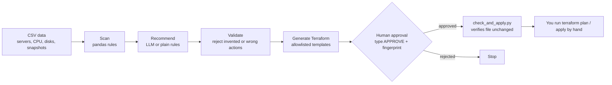

# AI Cloud Cost Optimizer

A Python tool that scans cloud usage data, finds wasted spending (idle servers, unattached disks, orphaned snapshots), recommends fixes, and prepares a Terraform change file. **Nothing is applied until a human approves it.**

Built as a learning project for a cloud engineering career path. It runs on sample CSV data today (no AWS account needed); see [Limitations](#limitations) and [Roadmap](#roadmap) for what is and isn't done.

## How it works



1. **Scan** - computes each server's average and peak CPU and finds unattached volumes and old orphan snapshots, using plain pandas.
2. **Recommend** - an LLM (Google Gemini, structured JSON output) picks an action per resource. With no API key, or if the AI call fails, it falls back to simple rules.
3. **Validate** - code checks the recommendations: no invented resources, no duplicates, no skipped resources, and only actions that make sense for the resource type.
4. **Generate Terraform** - only actions on a fixed allowlist have templates. The AI never writes Terraform or resource IDs.
5. **Approve** - the reviewer sees every change and the monthly saving, then must type `APPROVE <fingerprint>`. The fingerprint is a SHA-256 hash of the generated file.
6. **Verify** - `check_and_apply.py` recomputes the hash and refuses to continue if the file was edited after approval. It does not run `terraform apply`; a person does.

## Design decisions

- **Code computes, the AI explains.** All dollar figures come from the scan data, never from the model.
- **Use peak, not average.** A server averaging 24% CPU can still peak at 90% (a nightly batch job). Right-sizing on the average would cause an outage, so rules use peak CPU.
- **Allowlist, not free-form generation.** An unknown action raises an error instead of producing infrastructure code.
- **No auto-apply.** The code for applying changes does not exist in this repo.
- **Fail safe.** If the AI call fails, the tool falls back to rules instead of guessing.

## Sample output

```
[scan] 8 resources checked
[recommend] no API key, using plain rules
[validate] recommendations passed all checks

old-test   stop_instance    risk=low    saves $ 140.16  (peak CPU below 5%)
vol-03     delete_volume    risk=medium saves $  40.00  (not attached to any server)
vol-04     delete_volume    risk=medium saves $  20.00  (not attached to any server)
snap-01    delete_snapshot  risk=medium saves $   5.00  (source volume gone and older than 90 days)
snap-02    delete_snapshot  risk=medium saves $   5.00  (source volume gone and older than 90 days)

Total monthly saving: $210.16   |   per year: $2521.92
File fingerprint: 1729174c
To approve, type exactly:  APPROVE 1729174c   (anything else rejects):
```

The sample data includes a deliberate trap: `batch-job` averages 24.4% CPU but peaks at 90%, and is correctly left alone.

## Run it

Requires Python 3.9+.

```
pip install -r requirements.txt
python pipeline.py
python check_and_apply.py
```

To use the AI path, set a Gemini API key from [Google AI Studio](https://aistudio.google.com/apikey) as an environment variable (never put it in the code):

```
# PowerShell
$env:GEMINI_API_KEY="your-key"

# Linux / macOS
export GEMINI_API_KEY="your-key"
```

and install the optional libraries: `pip install google-genai pydantic`.

## Limitations

- Reads **sample CSV files**, not a live AWS account. Resource IDs in the generated Terraform are placeholders.
- Uses **CPU only**. Memory, disk I/O and network are not checked, so a right-size or stop recommendation could be unsafe.
- **Delete actions are comments, not working code.** Terraform can only delete resources it already manages, so unmanaged volumes and snapshots must be imported or removed another way. Always back up before deleting.
- Costs are **approximate** on-demand prices, and snapshots are billed incrementally, so snapshot savings are an upper bound.
- Thresholds (5% idle, 90 days old) are fixed example values, not tuned.

## Roadmap

- [ ] Replace CSV input with `boto3` calls to Cost Explorer and CloudWatch
- [ ] Add memory metrics through the CloudWatch agent
- [ ] Right-sizing recommendations (smaller instance type) with a safety margin
- [ ] Run the approval step through a GitHub Actions workflow
- [ ] Score the AI's recommendations against known-correct answers
- [ ] Use the AWS pricing API instead of fixed prices

## Project layout

| File | Purpose |
|---|---|
| `pipeline.py` | Scan, recommend, validate, generate Terraform, approval gate |
| `check_and_apply.py` | Verifies the approved file is unchanged and prints the manual steps |
| `*.csv` | Sample data: servers, CPU readings, disks, snapshots |
